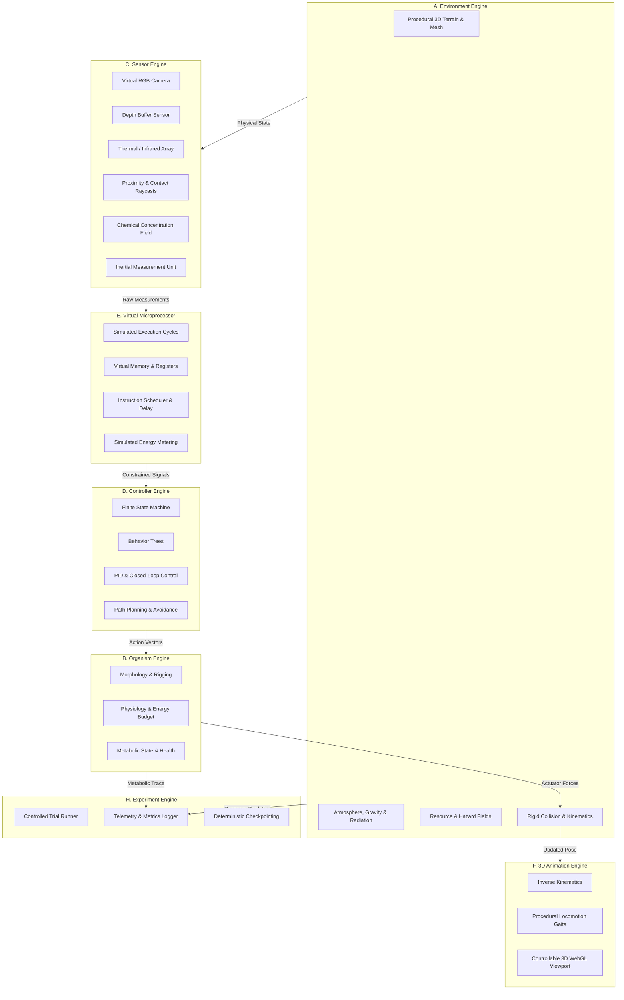

# MULTIGALAXIAL LIFE — LEVEL 2: MASTER RESEARCH & ENGINEERING PLAN
## Sensor-Driven Artificial Life, Microprocessor Simulation, Controllable 3D Animation, and Multigalactic Ecosystem Research Platform

### 1. Executive Summary & Epistemological Scope
**MULTIGALAXIAL LIFE — LEVEL 2** extends the established scientific computer vision and astrobiological modeling framework of Level 1 into an operational, modular, sensor-driven artificial-life (A-Life) simulation and computational experimentation platform.

> [!IMPORTANT]
> **Scientific Demarcation Principle:** This platform models computational analogues of living systems and hypothetical exobiological scenarios. It is an exploration of physical, informational, and computational constraints on self-organizing agents in synthetic environments. It is **not** an assertion that extraterrestrial organisms have been discovered, nor should synthetic simulated agent behaviors be confused with verified biological evidence.

---

### 2. Core Scientific Questions
1. **Physical-Metabolic Coupling:** How do varying gravity ($g \in [0.1, 3.0]\,g_\oplus$), atmospheric density ($\rho \in [0.01, 10]\,\text{bar}$), and thermodynamic energy flux constrain the morphological efficiency and energy budgets of autonomous organisms?
2. **Sensorimotor Scaling & Uncertainty:** How do sensor resolution, latency, noise models (Gaussian, Poisson, dropouts), and field-of-view limits impact survival efficiency in non-uniform resource landscapes?
3. **Computational Resource Bottlenecks:** What is the minimal virtual processing budget (cycles, memory words, scheduling latency) required to sustain stable goal-directed locomotion, obstacle avoidance, and adaptive foraging?
4. **Ecosystem Stability & Carrying Capacity:** Under what spatial resource regeneration rates and metabolic consumption limits do multi-agent populations achieve stable Lotka-Volterra equilibria vs. catastrophic extinction cascades?

---

### 3. Modular System Architecture (Subsystems A through J)

---

### 4. 8-Part / 40-Volume Research Programme Structure
The scientific foundations, engineering specifications, experimental protocols, and validation evidence for Level 2 are published across 40 formal research volumes (Parts I through VIII):

- **PART I (Volumes 1–5):** System Architecture, Epistemology, Requirements, Data Provenance, and Real-Time Orchestration.
- **PART II (Volumes 6–10):** 3D Planetary Worlds, Atmospheres, Alternative Habitats, Resource Fields, and Environmental Physics.
- **PART III (Volumes 11–15):** Procedural Organism Morphology, Artificial Physiology, Life-Cycle Dynamics, Alternative Biochemistries, and Lifecycle Management.
- **PART IV (Volumes 16–20):** Virtual Cameras, Thermal/Spectral Sensors, Environmental Sensors, Sensor Fusion, and Autonomous Perception.
- **PART V (Volumes 21–25):** Behavioral Controllers, PID & Feedback Control, Virtual Microprocessor Architecture, Embedded Interfaces, and Resource-Constrained Intelligence.
- **PART VI (Volumes 26–30):** Procedural Rigging, Inverse Kinematics, Interactive 3D Controls, Procedural Gait Animation, and Multi-Organism Ecosystem Dynamics.
- **PART VII (Volumes 31–35):** Machine Learning for Perception, Reinforcement Learning, Evolutionary Adaptation, Communication Channels, and Multigalactic Scenario Generation.
- **PART VIII (Volumes 36–40):** Scientific Experiment Design, Robustness Benchmarks, Reproducibility Protocols, Integrated 3D Laboratory, and Scientific Validation.

---

### 5. Implementation Roadmap & Staged Milestones
1. **Milestone 1 (Foundations):** Formal system planning documents, schema definitions, and mathematical specifications.
2. **Milestone 2 (Working Vertical Slice):** End-to-end integration of procedural terrain, an articulated multi-segmented organism, raycast proximity and chemical sensors, virtual microprocessor throttling, FSM controller, 3D WebGL visualization, and automated metric logging.
3. **Milestone 3 (Core Subsystems):** Full implementation of all 10 Level 2 modules with unit test coverage.
4. **Milestone 4 (Experimentation & 14 Acceptance Tests):** Verification of all 14 mandatory acceptance tests.
5. **Milestone 5 (40 Research Volumes):** Compilation of the 40 Level 2 research volumes strictly verified at 40 pages per volume.
6. **Milestone 6 (Interactive Deployment):** Multi-modal Streamlit 3D flight and artificial life laboratory deployment with live public tunneling.
